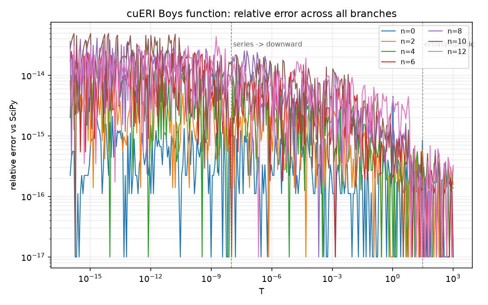
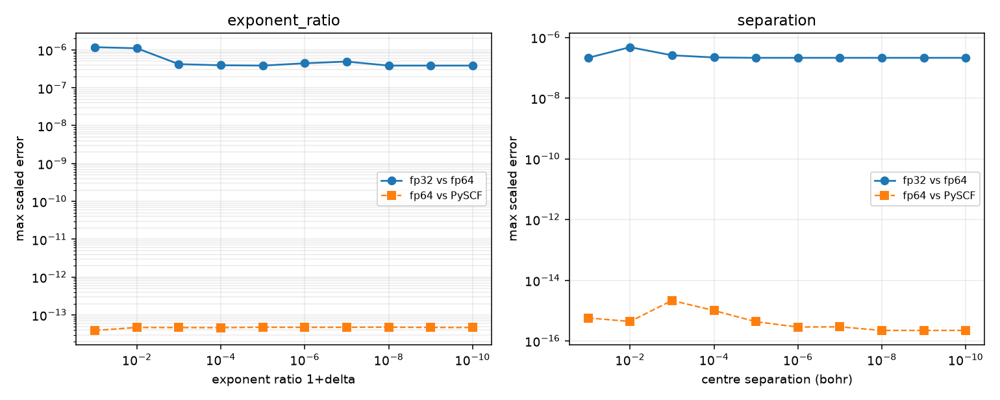

# cuERI measurement report

Generated by `scripts/make_results.py` from the CSVs in `results/`.

**Hardware tier: C** - Tier C: no CUDA toolkit; CPU backend only  
Platform: macOS-27.0.1-arm64-arm-64bit-Mach-O  
CPU: Apple M3 (8 logical cores)  
Compiler: Apple clang version 21.0.0 (clang-2100.3.34.2)  
nvcc: none  
GPU: none

Cells that could not be measured say "not measured (no GPU on build machine)". Every other number in this file comes from a CSV or JSON in `results/`.

## One-electron integrals vs PySCF/libcint

Reference: PySCF/libcint 2.14.0. Relative errors use the stated floor (1e-6 * max|ref| in class); `scaled` is the maximum absolute error divided by the largest reference element in the class.

| precision | shell class | max rel error | max scaled error | worst case |
|---|---|---|---|---|
| fp64 | dd | 1.560e-13 | 1.549e-14 | benzene/6-31g* (nuclear) |
| fp64 | pd | 1.242e-12 | 3.998e-14 | ch4/6-31g* (nuclear) |
| fp64 | pp | 4.428e-12 | 3.910e-15 | ch4/6-31g (nuclear) |
| fp64 | sd | 4.323e-12 | 6.802e-15 | ch4/6-31g* (nuclear) |
| fp64 | sp | 3.159e-12 | 8.169e-15 | ch4/6-31g (nuclear) |
| fp64 | ss | 1.067e-09 | 4.246e-15 | benzene/6-31g (nuclear) |
| fp32 | dd | 1.889e-05 | 5.502e-08 | benzene/6-31g* (kinetic) |
| fp32 | pd | 1.044e-03 | 6.879e-07 | ch4/6-31g* (nuclear) |
| fp32 | pp | 3.622e-04 | 1.145e-07 | ch4/6-31g (nuclear) |
| fp32 | sd | 1.248e-03 | 1.842e-07 | ch4/6-31g* (nuclear) |
| fp32 | sp | 1.189e-03 | 3.082e-07 | ch4/6-31g (nuclear) |
| fp32 | ss | 1.581e-05 | 1.383e-08 | ch4/6-31g (kinetic) |

## Two-electron integrals vs PySCF/libcint

Reference: PySCF/libcint 2.14.0. Scaling as above; classes are `bra-pair-ket-pair` where each pair is the unordered angular-momentum pair.

| precision | shell class | max rel error | max scaled error | worst case |
|---|---|---|---|---|
| fp64 | dd-dd | 1.555e-11 | 5.865e-15 | benzene/6-31g* |
| fp64 | dd-pd | 1.942e-11 | 3.289e-14 | benzene/6-31g* |
| fp64 | dd-pp | 4.956e-12 | 9.691e-15 | benzene/6-31g* |
| fp64 | dd-sd | 3.483e-14 | 1.512e-14 | h2o/6-31g* |
| fp64 | dd-sp | 2.983e-11 | 4.487e-14 | benzene/6-31g* |
| fp64 | dd-ss | 4.080e-13 | 4.517e-14 | benzene/6-31g* |
| fp64 | pd-dd | 1.942e-11 | 3.270e-14 | benzene/6-31g* |
| fp64 | pd-pd | 4.275e-11 | 2.611e-14 | benzene/6-31g* |
| fp64 | pd-pp | 7.611e-11 | 2.103e-14 | benzene/6-31g* |
| fp64 | pd-sd | 1.348e-11 | 5.394e-14 | benzene/6-31g* |
| fp64 | pd-sp | 5.071e-11 | 2.754e-14 | benzene/6-31g* |
| fp64 | pd-ss | 6.165e-14 | 2.804e-14 | h2o/6-31g* |
| fp64 | pp-dd | 4.956e-12 | 9.691e-15 | benzene/6-31g* |
| fp64 | pp-pd | 7.619e-11 | 2.080e-14 | benzene/6-31g* |
| fp64 | pp-pp | 8.615e-12 | 2.022e-14 | benzene/6-31g |
| fp64 | pp-sd | 2.456e-11 | 2.514e-14 | benzene/6-31g* |
| fp64 | pp-sp | 1.342e-10 | 2.180e-14 | benzene/6-31g |
| fp64 | pp-ss | 1.215e-11 | 2.059e-14 | benzene/6-31g |
| fp64 | sd-dd | 3.467e-14 | 1.507e-14 | h2o/6-31g* |
| fp64 | sd-pd | 1.348e-11 | 5.415e-14 | benzene/6-31g* |
| fp64 | sd-pp | 2.456e-11 | 2.514e-14 | benzene/6-31g* |
| fp64 | sd-sd | 8.277e-12 | 2.838e-14 | benzene/6-31g* |
| fp64 | sd-sp | 1.304e-12 | 2.582e-14 | h2o/6-31g* |
| fp64 | sd-ss | 1.711e-13 | 1.881e-14 | h2o/6-31g* |
| fp64 | sp-dd | 2.983e-11 | 4.487e-14 | benzene/6-31g* |
| fp64 | sp-pd | 5.071e-11 | 2.737e-14 | benzene/6-31g* |
| fp64 | sp-pp | 1.341e-10 | 2.195e-14 | benzene/6-31g |
| fp64 | sp-sd | 1.309e-12 | 2.602e-14 | h2o/6-31g* |
| fp64 | sp-sp | 1.065e-11 | 2.516e-14 | benzene/6-31g |
| fp64 | sp-ss | 7.789e-13 | 2.103e-14 | benzene/6-31g |
| fp64 | ss-dd | 4.079e-13 | 4.529e-14 | benzene/6-31g* |
| fp64 | ss-pd | 6.165e-14 | 2.804e-14 | h2o/6-31g* |
| fp64 | ss-pp | 1.215e-11 | 2.059e-14 | benzene/6-31g |
| fp64 | ss-sd | 1.703e-13 | 1.875e-14 | h2o/6-31g* |
| fp64 | ss-sp | 7.793e-13 | 2.103e-14 | benzene/6-31g |
| fp64 | ss-ss | 9.719e-14 | 8.339e-15 | benzene/6-31g |
| fp32 | dd-dd | 3.069e-04 | 1.685e-07 | benzene/6-31g* |
| fp32 | dd-pd | 1.559e-04 | 1.289e-06 | benzene/6-31g* |
| fp32 | dd-pp | 1.898e-07 | 1.665e-07 | h2o/6-31g* |
| fp32 | dd-sd | 1.634e-04 | 3.047e-07 | benzene/6-31g* |
| fp32 | dd-sp | 1.853e-04 | 2.703e-07 | benzene/6-31g* |
| fp32 | dd-ss | 4.880e-07 | 1.458e-07 | ch4/6-31g* |
| fp32 | pd-dd | 1.559e-04 | 1.289e-06 | benzene/6-31g* |
| fp32 | pd-pd | 4.756e-07 | 4.756e-07 | ch4/6-31g* |
| fp32 | pd-pp | 4.120e-03 | 1.094e-06 | benzene/6-31g* |
| fp32 | pd-sd | 7.921e-04 | 1.910e-06 | benzene/6-31g* |
| fp32 | pd-sp | 6.512e-03 | 8.464e-07 | benzene/6-31g* |
| fp32 | pd-ss | 1.671e-04 | 1.190e-06 | benzene/6-31g* |
| fp32 | pp-dd | 1.898e-07 | 1.665e-07 | h2o/6-31g* |
| fp32 | pp-pd | 4.120e-03 | 1.094e-06 | benzene/6-31g* |
| fp32 | pp-pp | 8.323e-06 | 2.708e-07 | benzene/sto-3g |
| fp32 | pp-sd | 3.786e-07 | 1.622e-07 | h2o/6-31g* |
| fp32 | pp-sp | 1.633e-04 | 4.318e-07 | benzene/sto-3g |
| fp32 | pp-ss | 5.227e-07 | 3.830e-07 | ch4/sto-3g |
| fp32 | sd-dd | 1.634e-04 | 3.047e-07 | benzene/6-31g* |
| fp32 | sd-pd | 7.921e-04 | 1.910e-06 | benzene/6-31g* |
| fp32 | sd-pp | 3.786e-07 | 1.622e-07 | h2o/6-31g* |
| fp32 | sd-sd | 7.786e-04 | 3.561e-07 | benzene/6-31g* |
| fp32 | sd-sp | 1.055e-03 | 5.405e-07 | benzene/6-31g* |
| fp32 | sd-ss | 3.919e-04 | 3.341e-07 | ch4/6-31g* |
| fp32 | sp-dd | 1.853e-04 | 2.703e-07 | benzene/6-31g* |
| fp32 | sp-pd | 6.512e-03 | 8.464e-07 | benzene/6-31g* |
| fp32 | sp-pp | 1.633e-04 | 4.318e-07 | benzene/sto-3g |
| fp32 | sp-sd | 1.055e-03 | 5.405e-07 | benzene/6-31g* |
| fp32 | sp-sp | 8.577e-04 | 4.951e-07 | benzene/sto-3g |
| fp32 | sp-ss | 5.212e-04 | 3.843e-07 | benzene/sto-3g |
| fp32 | ss-dd | 4.880e-07 | 1.458e-07 | ch4/6-31g* |
| fp32 | ss-pd | 1.671e-04 | 1.190e-06 | benzene/6-31g* |
| fp32 | ss-pp | 5.227e-07 | 3.830e-07 | ch4/sto-3g |
| fp32 | ss-sd | 3.919e-04 | 3.341e-07 | ch4/6-31g* |
| fp32 | ss-sp | 5.212e-04 | 3.843e-07 | benzene/sto-3g |
| fp32 | ss-ss | 6.463e-07 | 6.463e-07 | ch4/6-31g |

## RHF closed loop (cuERI integrals only)

| molecule | basis | nbf | electrons | SCF iterations | E(cuERI) / Ha | E(PySCF) / Ha | abs delta / Ha |
|---|---|---|---|---|---|---|---|
| h2o | sto-3g | 7 | 10 | 63 | -74.963023138457 | -74.963023138469 | 1.241e-11 |
| h2o | 6-31g | 13 | 10 | 60 | -75.983974472707 | -75.983974472722 | 1.455e-11 |

## Boys function corner cases

3900 values over T = 1e-16 .. 1e3 and n = 0..12, compared with SciPy.

- worst relative error: 4.940e-14 at T = 8.0603614088612971e-15, n = 10, branch `taylor_small_T`
- branch `downward_recursion`: max relative error 2.887e-14
- branch `erf_asymptotic`: max relative error 7.355e-16
- branch `taylor_small_T`: max relative error 4.940e-14

## fp32 vs fp64 error growth

| study | worst fp32-vs-fp64 scaled error | location | max amplification vs mildest point |
|---|---|---|---|
| exponent_ratio | 1.179e-06 | eri pd-dd at 1.000e-01 | 4.00x |
| separation | 4.762e-07 | eri ss-ss at 1.000e-02 | 3.66x |

Worst fp64-vs-PySCF scaled error in the sweep: 4.764e-14 (exponent_ratio, eri, ss-dd).

## Schwarz screening

| molecule | basis | tolerance | quartets | skipped | skip fraction | max deviation | within bound |
|---|---|---|---|---|---|---|---|
| h2o | 6-31g* | 0e+00 | 1540 | 0 | 0.00% | 0.000e+00 | true |
| h2o | 6-31g* | 1e-14 | 1540 | 0 | 0.00% | 0.000e+00 | true |
| h2o | 6-31g* | 1e-12 | 1540 | 0 | 0.00% | 0.000e+00 | true |
| h2o | 6-31g* | 1e-10 | 1540 | 0 | 0.00% | 0.000e+00 | true |
| h2o | 6-31g* | 1e-08 | 1540 | 0 | 0.00% | 0.000e+00 | true |
| benzene | sto-3g | 0e+00 | 45150 | 0 | 0.00% | 0.000e+00 | true |
| benzene | sto-3g | 1e-14 | 45150 | 2664 | 5.90% | 2.036e-17 | true |
| benzene | sto-3g | 1e-12 | 45150 | 2664 | 5.90% | 2.036e-17 | true |
| benzene | sto-3g | 1e-10 | 45150 | 2721 | 6.03% | 1.113e-11 | true |
| benzene | sto-3g | 1e-08 | 45150 | 3384 | 7.50% | 6.794e-09 | true |
| benzene | 6-31g | 0e+00 | 408156 | 0 | 0.00% | 0.000e+00 | true |
| benzene | 6-31g | 1e-14 | 408156 | 14280 | 3.50% | 7.969e-15 | true |
| benzene | 6-31g | 1e-12 | 408156 | 21219 | 5.20% | 9.967e-13 | true |
| benzene | 6-31g | 1e-10 | 408156 | 33348 | 8.17% | 8.286e-11 | true |
| benzene | 6-31g | 1e-08 | 408156 | 44889 | 11.00% | 9.503e-09 | true |

## Benchmark

Median wall time over three passes after one warm-up; screen tolerance 1e-10.

| molecule | basis | nbf | ERI cpu-1thread / ms | ERI cpu-openmp / ms | speedup | integrals/s (openmp) |
|---|---|---|---|---|---|---|
| benzene | 6-31g | 66 | 5030.45 | 1136.10 | 4.43x | 1.670e+07 |
| benzene | 6-31g* | 102 | 9381.26 | 1909.34 | 4.91x | 5.669e+07 |
| benzene | sto-3g | 36 | 1377.56 | 250.47 | 5.50x | 6.706e+06 |
| ch4 | 6-31g | 17 | 40.21 | 8.44 | 4.76x | 9.897e+06 |
| h2 | sto-3g | 2 | 0.17 | 0.14 | 1.18x | 1.129e+05 |
| h2o | 6-31g | 13 | 14.06 | 2.77 | 5.08x | 1.033e+07 |
| h2o | 6-31g* | 19 | 20.65 | 4.17 | 4.95x | 3.123e+07 |
| h2o | sto-3g | 7 | 3.85 | 0.97 | 3.98x | 2.482e+06 |

MD vs Rys (cpu-openmp, fp64):

| molecule | basis | MD / ms | Rys / ms | Rys/MD |
|---|---|---|---|---|
| benzene | 6-31g | 1136.10 | 1431.44 | 1.26 |
| benzene | 6-31g* | 1909.34 | 2831.03 | 1.48 |
| benzene | sto-3g | 250.47 | 346.53 | 1.38 |
| ch4 | 6-31g | 8.44 | 8.85 | 1.05 |
| h2 | sto-3g | 0.14 | 0.14 | 1.02 |
| h2o | 6-31g | 2.77 | 3.24 | 1.17 |
| h2o | 6-31g* | 4.17 | 6.14 | 1.47 |
| h2o | sto-3g | 0.97 | 1.31 | 1.36 |

CUDA rows: 0 measured, 32 not measured. Unmeasured cells read "not measured (no GPU on build machine)".

## Registers and occupancy per angular-momentum class

Rows: 20; statuses: not measured.

| angular class | status | registers/thread | occupancy | memory throughput | SM throughput |
|---|---|---|---|---|---|
| ss-ss | not measured | - | - | - | - |
| ss-sp | not measured | - | - | - | - |
| ss-pp | not measured | - | - | - | - |
| sp-sp | not measured | - | - | - | - |
| sp-pp | not measured | - | - | - | - |
| pp-pp | not measured | - | - | - | - |
| ss-sd | not measured | - | - | - | - |
| sp-sd | not measured | - | - | - | - |
| pp-sd | not measured | - | - | - | - |
| sd-sd | not measured | - | - | - | - |
| ss-pd | not measured | - | - | - | - |
| sp-pd | not measured | - | - | - | - |
| pp-pd | not measured | - | - | - | - |
| pd-pd | not measured | - | - | - | - |
| ss-dd | not measured | - | - | - | - |
| sp-dd | not measured | - | - | - | - |
| pp-dd | not measured | - | - | - | - |
| sd-dd | not measured | - | - | - | - |
| pd-dd | not measured | - | - | - | - |
| dd-dd | not measured | - | - | - | - |

Reason: Tier C build: no CUDA toolkit and no NVIDIA GPU on the build machine; no kernel was compiled or run, so registers, spills and occupancy do not exist.

## Generated figures

- [results/figures/boys_corner_cases.png](figures/boys_corner_cases.png)
- [results/figures/precision_error_growth.png](figures/precision_error_growth.png)

